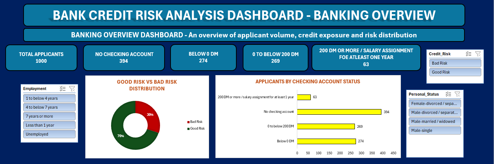
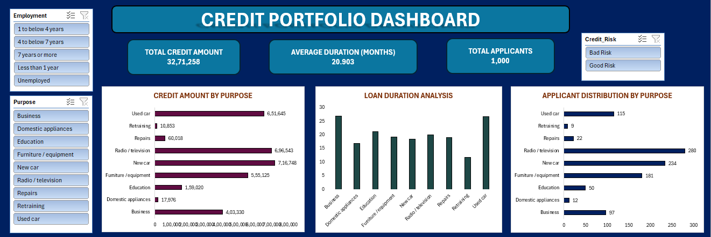
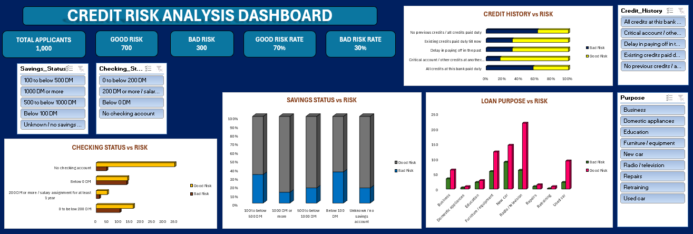
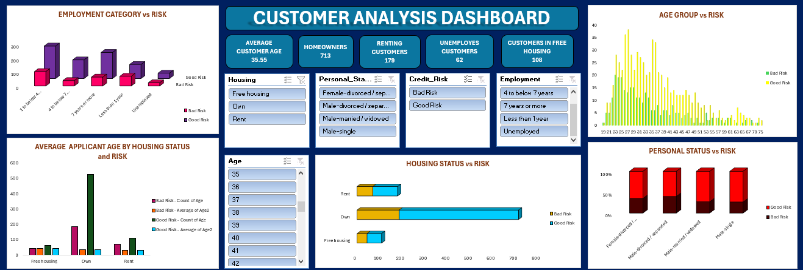

# Bank and Credit Risk Analysis | Excel Dashboard Project

An interactive, four-dashboard Excel project built to explore customer and credit-risk information using the German Credit dataset.

## Project Overview

This project analyses **1,000 credit applicants** and presents the results through four Excel dashboards. It uses PivotTables, PivotCharts, KPI cards, and slicers to make important patterns easier to explore.

## Dashboards

| Dashboard | Purpose |
|---|---|
| **Banking Overview** | High-level summary of the applicant dataset and key banking indicators. |
| **Credit Portfolio** | Overview of credit amounts and portfolio-level measures. |
| **Credit Risk Analysis** | Compares applicants classified as Good Risk and Bad Risk. |
| **Customer Analysis** | Explores applicant characteristics such as personal status and other customer attributes. |

## Key Findings

- **1,000** applicants are included in the dataset.
- **700 (70%)** are classified as Good Risk.
- **300 (30%)** are classified as Bad Risk.
- The total credit amount in the dataset is **3,271,258 DM**.
- The average credit amount is **3,271.26 DM**.

> Currency note: The original dataset records credit amounts in Deutsche Mark (DM). Values are therefore not labelled as INR.

## Tools and Excel Features

- Microsoft Excel
- PivotTables and PivotCharts
- KPI cards
- Slicers and interactive filtering
- Data cleaning and formatting
- Dashboard design and data visualization

## Dataset

The project uses the **German Credit dataset** (`german.data`), containing 1,000 applicant records and fields such as credit duration, credit amount, credit history, purpose, age, housing, employment, and credit-risk classification.

## Repository Contents

- `Bank Credit Risk Analysis.xlsx` — Excel workbook containing the source data, PivotTables, and four dashboards.
- `README.md` — Project documentation.
- `images/` — Dashboard screenshots (to be added).

## Dashboard Previews

Add your four screenshots to an `images` folder in this repository, using these exact filenames:

1. `banking-overview.png`
2. `credit-portfolio.png`
3. `credit-risk-analysis.png`
4. `customer-analysis.png`

Then the images can be displayed here:

### 1. Banking Overview

### 2. Credit Portfolio

### 3. Credit Risk Analysis

### 4. Customer Analysis

## How to Explore the Workbook

1. Download `Bank Credit Risk Analysis.xlsx` from this repository.
2. Open the workbook in Microsoft Excel.
3. Navigate to the four dashboard worksheets.
4. Use the available slicers and filters to interact with the dashboard views.

## Learning Outcomes

- Summarised applicant data using PivotTables.
- Created visual comparisons with PivotCharts.
- Designed multiple dashboards from a common dataset.
- Used KPI cards and slicers to support interactive reporting.
- Practised communicating data patterns through Excel visualizations.

## Disclaimer

This is an educational data-analysis project. The analysis is for learning and demonstration purposes only; it is not a credit-scoring model, financial advice, or a basis for real lending decisions.
